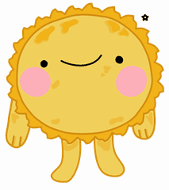
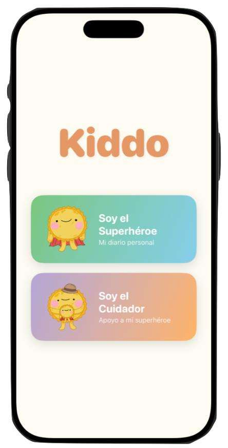
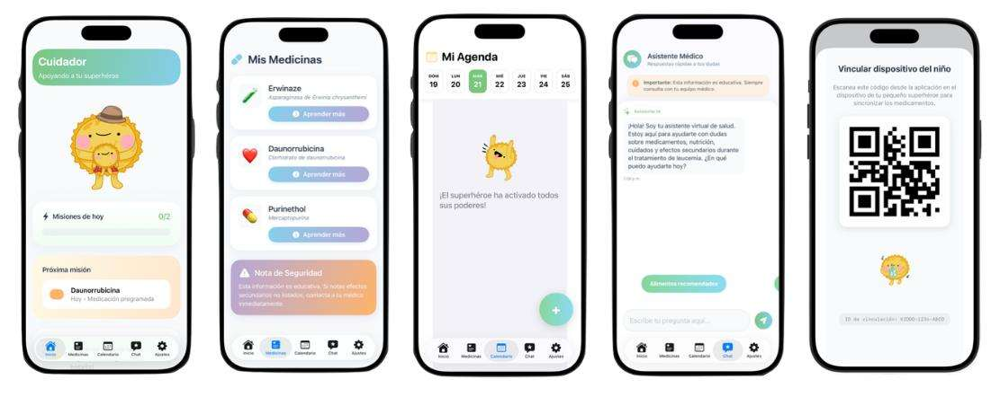
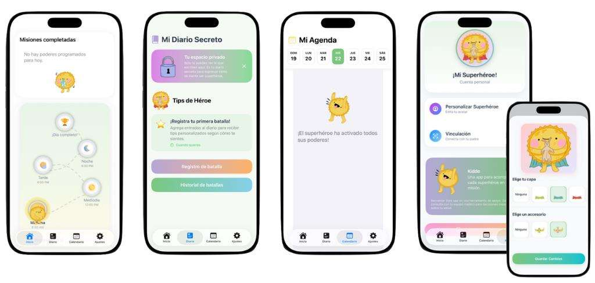

<p align="center">
  
</p>

<h1 align="center">Kiddo</h1>

<p align="center">
  <a href="README.md">Español</a> · <b>English</b>
</p>

<p align="center">
  <b>A companion app for pediatric oncology that combines a superhero narrative, on-device predictive Machine Learning and a conversational assistant with clinical knowledge, so the child feels like the hero of their story and the caregiver feels informed.</b>
</p>

> ⚠️ **Disclaimer:** Kiddo is an academic prototype. The information it shows is educational, **it does not replace the medical team's advice**, and it has not yet been validated by a pediatric oncologist.

## Contents

1. [General information](#1-general-information)
2. [Description](#2-description)
3. [Users](#3-users)
4. [Tools and technologies](#4-tools-and-technologies)
5. [How to run it](#5-how-to-run-it)
6. [Screens and features](#6-screens-and-features)
7. [Data flow](#7-data-flow)
8. [Repository structure](#8-repository-structure)
9. [Project status](#9-project-status)
10. [Next steps](#10-next-steps)
11. [Authors](#11-authors)

---

## 1. General information

| | |
|---|---|
| Name | Kiddo |
| Type | iOS app |
| Start date | April 18, 2026 |
| Delivery date | April 20, 2026 |
| Progress | ≈ 85–90 % |
| Institution | Universidad de las Américas Puebla (UDLAP) |

---

## 2. Description

Kiddo is a companion app for pediatric oncology. It combines:

- a **superhero narrative**, so the child feels like the protagonist of their treatment;
- **on-device predictive Machine Learning**, which estimates the times of day when the child is likely to feel more fatigue or pain;
- a **conversational assistant** with educational oncology information, so the caregiver feels informed.

---

## 3. Users

Pediatric oncology patients and their caregivers.

### Main needs
- An intuitive, easy-to-understand interface, with suitable font sizes and colors, following design and accessibility guidelines.
- Simple and motivating logging for the child.
- Friendly, child-oriented designs and illustrations.
- Accurate information from reliable, expert sources.
- Privacy of the information entered.

---

## 4. Tools and technologies

| | |
|---|---|
| Language | Swift |
| Interface | SwiftUI |
| Persistence | SwiftData + `@AppStorage` (UserDefaults) |
| Machine Learning | Core ML — `FatigueModel` and `PainModel` (MLBoostedTreeRegressor, trained in Swift Playgrounds) |
| Conversational assistant | FoundationModels (Apple's on-device language model) |
| Notifications | UserNotifications |
| QR code | Core Image |
| Tools | Xcode 26 and Simulator, Git/GitHub, Affinity Designer 2 |

---

## 5. How to run it

**Requirements**
- A Mac with Xcode 26.
- iOS 26.0 or later (the project's minimum version).
- The FoundationModels assistant requires an Apple Intelligence–compatible device (iPhone 15 Pro or later with iOS 26).

**Steps**
1. Clone or download this repository.
2. Open `Kiddo.xcodeproj` in Xcode.
3. Choose the **Kiddo** scheme and a simulator or iPhone.
4. Run the app (▶︎) and allow notifications.
5. Choose a profile: **Soy el Superhéroe** (I'm the Superhero) or **Soy el Cuidador** (I'm the Caregiver).

> To see the model's predictions, `PredictionEngine` needs at least 20 diary entries. Until then, a heuristic mode based on averages is used.

---

## 6. Screens and features

> The app's interface is in Spanish; English translations are shown in parentheses.

### 6.1 Role selection (onboarding)

<p align="center"></p>

The first time the app is opened, the user chooses between two profiles shown as visual cards: **"Soy el Superhéroe"** (I'm the Superhero — my personal diary) or **"Soy el Cuidador"** (I'm the Caregiver — support for my superhero). This choice defines all subsequent navigation.

**Permissions:** before entering, the app asks for permission to send notifications, which are essential for medication and appointment reminders.

### 6.2 Caregiver profile



- **Home:** caregiver avatar, a "Misiones de hoy" (Today's missions) bar with progress, a "Próxima misión" (Next mission) card with the medication name (e.g. Blincyto) and time, and a panel about the child's diary with care tips.
- **Medications / New entry:** form to schedule medications or medical appointments. Users choose the entry type, the medication, date and start time, turn on weekly repetition and add notes (dose, reminders).
- **Calendar / Mi Agenda (My Schedule):** weekly view with a day selector listing events and their times. New entries can be added from here.
- **Chat / Medical assistant:** chat that answers questions about medications, nutrition, care and side effects during leukemia treatment. It includes a disclaimer stating that the information is educational and should always be checked with the medical team.
  > In the current version, the Chat tab shows `AIChatViewFF` (`Views/ChatView.swift`), a demo version with quick questions and predefined answers. The FoundationModels-powered chat (`AIChatView`, in `Views/ChatView 2.swift`) is implemented but not yet connected to the tab.
- **Settings:** "Cuidador – Cuenta de apoyo" (Caregiver – support account) profile card, privacy, linking with the child (QR code) and sign out.

### 6.3 Child / Superhero profile



- **Home:** a visual map of the day's missions by time of day (Morning 8:00 AM, Noon 12:00 PM, Afternoon 4:00 PM and Night 8:00 PM), connected by a path that ends in a "¡Día completo!" (Day complete!) trophy. Completing a mission shows a ✓ and raises the progress bar. A motivational message appears below.
- **Diary / Mi Diario Secreto (My Secret Diary):** a private space with a "Tu espacio privado" (Your private space) card, personalized "Tips de Héroe" (Hero Tips) based on previous entries (e.g. *"Make the most of feeling good right now"*, *"Your star moment is at 6pm"*) and two large buttons: "Registro de batalla" (Battle log) and "Historial de batallas" (Battle history).
- **Battle log:** mood (Excellent, Good, Okay, Bad, Very bad), energy level (0–10), pain level (0–10), "Villanos de hoy" (Today's villains: mild/moderate/extreme tiredness, nausea, headache, dizziness, loss of appetite, stomach ache, trouble sleeping, irritability, none) and notes.
- **Calendar:** a simplified view with the child's scheduled medications.
- **Settings / Customize your superhero:** avatar cape (green, blue, red or purple) and accessory (frog or bunny plush), linking with the caregiver and sign out.

### 6.4 Notifications
Local notifications (e.g. *"Blincyto – Tienes un evento próximo"*, "You have an upcoming event") in both profiles, so medication is given on time.

---

## 7. Data flow

### 7.1 Overall architecture
The app follows an MVVM pattern adapted to SwiftUI's declarative paradigm, with four layers:

| Layer | Responsibility | Key files |
|---|---|---|
| Presentation (Views) | User input and UI rendering | `ContentView.swift`, `MainViewHijo.swift`, `MainViewPadre.swift` |
| Coordination (Managers / Engines) | Business logic, persistence and processing | `DataManager.swift`, `NotificationManager.swift`, `PredictionEngine.swift`, `SuggestionEngine.swift`, `OncologyChatService.swift` |
| Model (Models) | Persistable and domain data structures | `DiaryEntry.swift`, `CalendarEvent.swift`, `Medication.swift`, `Avatar.swift`, `ChatMessage.swift` |
| Persistence | Physical data storage | SwiftData `ModelContainer` + `@AppStorage` (UserDefaults) |

### 7.2 Initialization and role selection
When the app launches, `KiddoApp.swift`:
1. Requests notification permission with `NotificationManager.shared.requestPermission()` and assigns the global `NotificationDelegate`.
2. Builds the SwiftData `ModelContainer` with the `DiaryEntry` and `CalendarEvent` entities and injects it with `.modelContainer(sharedModelContainer)`.
3. Loads the Core ML models (`FatigueModel` and `PainModel`) with `PredictionEngine.shared.loadModels()` in an asynchronous task.

`RootView` wraps `ContentView` and injects a `DataManager` as an `@EnvironmentObject`, so any view can access CRUD operations.

In `ContentView.swift`, two `@AppStorage` properties (`hasCompletedOnboarding` and `userRole`) drive navigation: the first time, `LoginScreen` is shown to choose a role; afterwards the app opens `MainViewPadre()` (caregiver) or `MainView()` (superhero) directly. The choice is saved in UserDefaults.

### 7.3 Writing data

**Medication or appointment entry (Caregiver):** the form data (title, type, date, time, description) is stored in a `CalendarEvent` (a SwiftData `@Model`) inserted into the `modelContext`. At the same time, `NotificationManager.shared.scheduleNotification(for:)` schedules a local notification with `UNCalendarNotificationTrigger` one minute before the event, with `interruptionLevel = .timeSensitive` so it arrives even in Do Not Disturb mode.

**Battle log (Child):** the view calls `dataManager.addEntry(fatigue:pain:wellbeing:at:)`, which:
1. Creates a `DiaryEntry` with a UUID and timestamp.
2. Inserts it with `modelContext.insert(entry)`.
3. Saves it with `modelContext.save()`.

### 7.4 Reading and processing
- **SwiftData `@Query`** in views with reactive lists (calendar, battle history), which update automatically when the data changes.
- **`DataManager`** for programmatic operations (`fetchAll()`, `fetchRecent(limit:)`, `entriesGroupedByHour()`, `averagesByHour()`, `hasEnoughDataForTraining()`), used mainly by the AI engines.

### 7.5 Artificial intelligence layer
- **PredictionEngine:** loads the two Core ML models, which take `hour`, `dayOfWeek` and `wellbeingScore` and predict fatigue and pain for each of the 24 hours of the day. `generateDailyInsight()` takes recent entries, runs the 24 predictions, ranks them by `energyScore` and returns a `DailyInsight` with the best hours, the worst hours and the peak energy hour. If the models are not available, `generateHeuristicInsight()` uses historical averages.
- **SuggestionEngine:** combines the `DailyInsight` with the user's context (latest entry, current time, trend computed with `calculateTrend()`) and produces suggestions ranked by urgency. `suggestions(for:recipient:)` adapts the language to the recipient: empathetic first-person messages for the child, informative ones for the caregiver.
- **OncologyChatService:** runs the assistant with FoundationModels. It keeps a `LanguageModelSession` with instructions that limit the model to educational oncology information and exposes three methods: single response (`respond(to:)`), streaming response (`streamResponse(to:)`) and structured output (`explainTopic(_:)`) typed with `@Generable struct OncologyExplanation`.
- **Knowledge base:** `Resources/OncologyKnowledge.json` with 33 topics (treatments, cancer types, medical terms, nutrition), each with its source: National Cancer Institute (NCI), American Cancer Society (ACS), ASCO and ALSF.

### 7.6 Notifications
Notifications are local and need no server. When a `CalendarEvent` is created, `NotificationManager` registers a `UNNotificationRequest` using the event id as identifier. If the event is changed or deleted, `cancelNotification(for:)` removes the pending request. `NotificationDelegate` sets `[.banner, .sound, .badge]` so notifications appear even while the app is open.

### 7.7 Key characteristics
- **Privacy by design:** all medical data (diary, medications, predictions and AI chat) is processed and stored locally on the device. There is no communication with external servers for sensitive data.
- **Reactivity:** SwiftData automatically updates views subscribed with `@Query`.
- **Dependency injection:** `DataManager` is injected as an `@EnvironmentObject` from `RootView`.
- **ML scalability:** `MLTrainer` can export user data to CSV to retrain the models in the future, laying the groundwork for per-child personalized learning.

---

## 8. Repository structure

```
Kiddo/
├── KiddoApp.swift            # Entry point, ModelContainer and RootView
├── ContentView.swift         # Role-based navigation
├── Views/                    # Screens: login, home, diary, calendar, chat, QR linking
├── Components/               # Reusable components (cards, diary, calendar, suggestions)
│   └── Caminito/             # Daily mission map and walking avatar
├── Animaciones/              # Frame-by-frame animations of Kiddo
├── Configuración/            # Settings, profile and avatar customization
├── Models/                   # DiaryEntry, CalendarEvent, Medication, Avatar, ChatMessage…
├── Copia de Managers/        # DataManager, NotificationManager, PredictionEngine, SuggestionEngine, OncologyChatService, MLTrainer
├── Utils/                    # QR generator, oncology knowledge tool, chat errors
├── Resources/                # FatigueModel.mlmodel, PainModel.mlmodel, OncologyKnowledge.json
└── Assets.xcassets/          # Illustrations, animation frames and icon
Kiddo.xcodeproj
KiddoTests/
KiddoUITests/
docs/                         # Images and GIF used in this README
```

---

## 9. Project status

**Approximate progress: 85–90 %.**

### Implemented

**Authentication and onboarding**
- [x] Role selection (Superhero / Caregiver) persisted with `@AppStorage`
- [x] Notification permission request on first launch
- [x] QR linking screen (generates the QR code; the full linking flow is pending)

**Caregiver profile**
- [x] Home with avatar, "Today's missions" and next medication
- [x] "New entry" form for medications and medical appointments
- [x] Events with date, time, weekly repetition and notes
- [x] "Mi Agenda" weekly calendar
- [x] Medical assistant chat (demo version in the tab; FoundationModels service with streaming implemented separately)
- [x] Settings with profile card, privacy, linking and sign out
- [x] Local notifications before each medical event

**Child / Superhero profile**
- [x] Visual map of the day's missions by time of day (Morning, Noon, Afternoon, Night)
- [x] Daily progress bar with a celebration at 100 %
- [x] "Mi Diario Secreto" as a private space
- [x] "Battle log" with mood, energy, pain, villains and notes
- [x] Battle history
- [x] Avatar customization (cape and accessory)
- [x] Personalized "Hero Tips" based on AI predictions

**Artificial intelligence**
- [x] `FatigueModel` and `PainModel` trained with MLBoostedTreeRegressor in Swift Playgrounds
- [x] `PredictionEngine` generating a `DailyInsight` with 24 hourly predictions
- [x] Heuristic fallback when there is not enough data yet
- [x] `SuggestionEngine` with 10+ rules differentiated by role
- [x] Trend calculation (improving / stable / worsening)
- [x] On-device oncology chat with FoundationModels and a JSON knowledge base

**Persistence and architecture**
- [x] Multi-entity SwiftData `ModelContainer`
- [x] `DataManager` with CRUD, limits and grouping by hour
- [x] Dependency injection with `@EnvironmentObject`
- [x] `NotificationManager` and `NotificationDelegate`

### Blockers or issues
- **FoundationModels availability:** the AI chat requires Apple Intelligence–compatible devices (iPhone 15 Pro or later with iOS 26), which limits the devices where it fully works. An informative fallback for other devices is still needed.
- **Minimum data for ML:** at least 20 diary entries are needed for meaningful predictions. During the first weeks only the heuristic engine is active; this still needs to be explained in the child's onboarding.
- **CloudKit pending:** `CloudkitManager.swift` is empty. Syncing between the caregiver's and the child's devices does not exist yet, and it is needed for the caregiver to see the superhero's entries.
- **Retraining in production:** `MLTrainer` only exports to CSV; a pipeline for each child to have personalized models trained on their own data is still missing.
- **No clinical validation yet:** none of the medical texts or suggestion rules have been reviewed by a pediatric oncologist. This is required before any release.

---

## 10. Next steps

- [ ] Implement `CloudKitManager` to sync `DiaryEntry` and `CalendarEvent` between the caregiver's and the child's devices using private CloudKit.
- [ ] Build the profile-linking flow (generate and scan a QR code or shared token using the `linkingToken` already declared in `ContentView`).
- [ ] Medical validation of all suggestion texts and the oncology JSON knowledge base by a pediatric oncologist.
- [ ] Informative chat fallback for devices without Apple Intelligence.
- [ ] Robust error handling in `PredictionEngine` and clear messages when there is not enough data.

---

## 11. Authors

| Name | Role |
|---|---|
| [Myrahis](https://github.com/MyrahisYSanluis) | Design and UI |
| [Valentina](https://github.com/Valoo-1201) | UX |
| [Alejandra](https://github.com/Abejandr4) | Technical development |

Universidad de las Américas Puebla (UDLAP)
