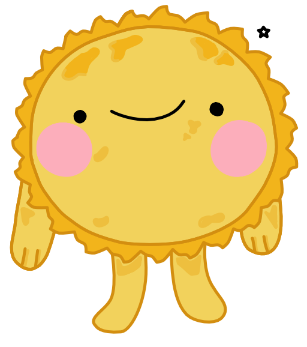
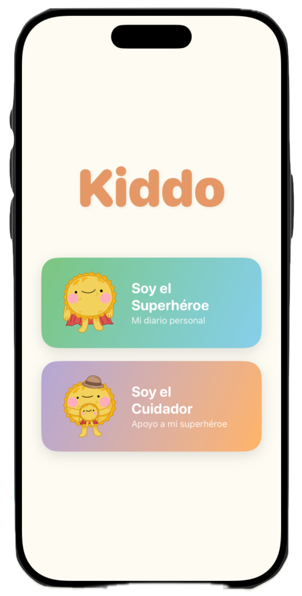
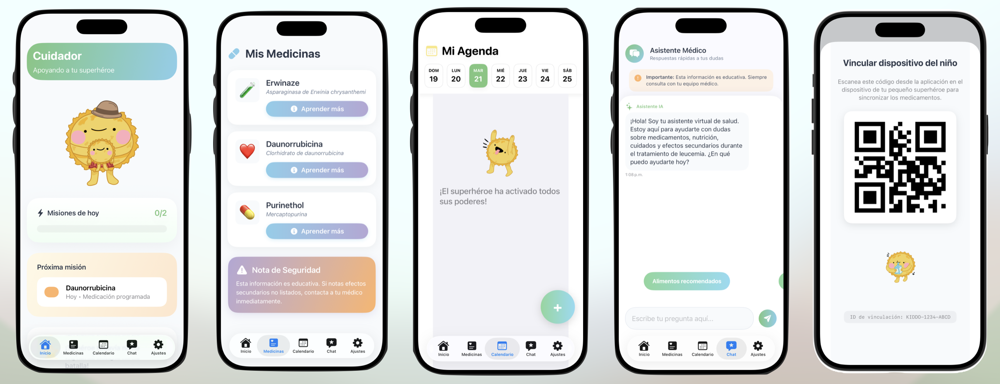
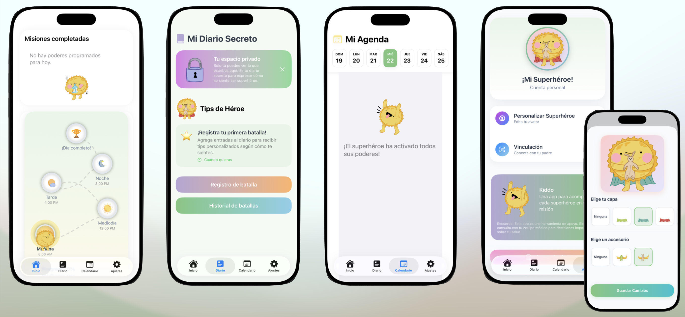

<p align="center">
  
</p>

<h1 align="center">Kiddo</h1>

<p align="center">
  <b>Español</b> · <a href="README.en.md">English</a>
</p>

<p align="center">
  <b>App de acompañamiento para oncología pediátrica que combina narrativa de superhéroes, Machine Learning predictivo on-device y un asistente conversacional con conocimiento clínico, para que el niño se sienta protagonista y su cuidador se sienta informado.</b>
</p>

> ⚠️ **Aviso:** Kiddo es un prototipo académico. La información que muestra es educativa, **no sustituye la consulta con el equipo médico** y aún no ha sido validada por un oncólogo pediátrico.

## Contenido

1. [Información general](#1-información-general)
2. [Descripción](#2-descripción)
3. [Usuarios](#3-usuarios)
4. [Herramientas y tecnologías](#4-herramientas-y-tecnologías)
5. [Cómo ejecutarla](#5-cómo-ejecutarla)
6. [Pantallas y funcionalidades](#6-pantallas-y-funcionalidades)
7. [Flujo de datos](#7-flujo-de-datos)
8. [Estructura del repositorio](#8-estructura-del-repositorio)
9. [Avance del proyecto](#9-avance-del-proyecto)
10. [Siguientes pasos](#10-siguientes-pasos)
11. [Autoras](#11-autoras)

---

## 1. Información general

| | |
|---|---|
| Nombre | Kiddo |
| Tipo | App para iOS |
| Fecha de inicio | 18 de abril de 2026 |
| Fecha de entrega | 20 de abril de 2026 |
| Avance | ≈ 85–90 % |
| Institución | Universidad de las Américas Puebla (UDLAP) |

---

## 2. Descripción

Kiddo es una app de acompañamiento para oncología pediátrica. Combina:

- una **narrativa de superhéroes**, para que el niño se sienta protagonista de su tratamiento;
- **Machine Learning predictivo on-device**, que estima a qué horas del día el niño tendrá más fatiga o dolor;
- un **asistente conversacional** con información oncológica educativa, para que el cuidador se sienta informado.

---

## 3. Usuarios

Pacientes oncológicos pediátricos y sus cuidadores.

### Necesidades principales
- Interfaz intuitiva y fácil de comprender, con tamaños de letra y colores adecuados y conforme a las guías de diseño y accesibilidad.
- Registros sencillos y motivadores para el niño.
- Diseños e ilustraciones amigables e infantiles.
- Información verdadera, de fuentes confiables y expertas.
- Privacidad de la información ingresada.

---

## 4. Herramientas y tecnologías

| | |
|---|---|
| Lenguaje | Swift |
| Interfaz | SwiftUI |
| Persistencia | SwiftData + `@AppStorage` (UserDefaults) |
| Machine Learning | Core ML — `FatigueModel` y `PainModel` (MLBoostedTreeRegressor, entrenados en Swift Playgrounds) |
| Asistente conversacional | FoundationModels (modelo de lenguaje de Apple, on-device) |
| Notificaciones | UserNotifications |
| Código QR | Core Image |
| Herramientas | Xcode 26 y Simulator, Git/GitHub, Affinity Designer 2 |

---

## 5. Cómo ejecutarla

**Requisitos**
- Mac con Xcode 26.
- iOS 26.0 o superior (versión mínima del proyecto).
- El asistente con FoundationModels necesita un dispositivo compatible con Apple Intelligence (iPhone 15 Pro o superior con iOS 26).

**Pasos**
1. Clona o descarga este repositorio.
2. Abre `Kiddo.xcodeproj` en Xcode.
3. Elige el esquema **Kiddo** y un simulador o iPhone.
4. Ejecuta la app (▶︎) y acepta el permiso de notificaciones.
5. Elige un perfil: **Soy el Superhéroe** o **Soy el Cuidador**.

> Para ver las predicciones del modelo, `PredictionEngine` necesita al menos 20 entradas en el diario. Mientras tanto se usa un modo heurístico con promedios.

---

## 6. Pantallas y funcionalidades

### 6.1 Selección de rol (onboarding)

<p align="center"></p>

La primera vez que se abre la app, el usuario elige entre dos perfiles con tarjetas visuales: **"Soy el Superhéroe"** (mi diario personal) o **"Soy el Cuidador"** (apoyo a mi superhéroe). Esta decisión define toda la navegación.

**Permisos:** antes de entrar, la app pide permiso para enviar notificaciones, indispensables para los recordatorios de medicamentos y citas médicas.

### 6.2 Perfil Cuidador



- **Inicio:** avatar del cuidador, barra de "Misiones de hoy" con progreso, tarjeta de "Próxima misión" con el nombre del medicamento (p. ej. Blincyto) y la hora, y un panel sobre el diario del niño con tips de cuidado.
- **Medicinas / Nuevo registro:** formulario para agendar medicamentos o citas médicas. Permite elegir el tipo de registro, la medicina, la fecha y la hora, activar la repetición semanal y añadir notas (dosis, recordatorios).
- **Calendario / Mi Agenda:** vista semanal con selector de días que lista los eventos y su hora. Permite añadir registros.
- **Chat / Asistente médico:** chat que responde dudas sobre medicamentos, nutrición, cuidados y efectos secundarios durante el tratamiento de leucemia. Incluye un aviso de que la información es educativa y debe consultarse con el equipo médico.
  > En la versión actual, la pestaña Chat muestra `AIChatViewFF` (`Views/ChatView.swift`), una versión de demostración con preguntas rápidas y respuestas predefinidas. El chat conectado a FoundationModels (`AIChatView`, en `Views/ChatView 2.swift`) está implementado, pero todavía no está enlazado a la pestaña.
- **Ajustes:** tarjeta de perfil "Cuidador – Cuenta de apoyo", privacidad, vinculación con el niño (código QR) y cerrar sesión.

### 6.3 Perfil Niño / Superhéroe



- **Inicio:** mapa visual de "misiones del día" por momentos (Mañana 8:00, Mediodía 12:00, Tarde 4:00 y Noche 8:00) unidos por un camino que termina en una copa de "¡Día completo!". Al completar una misión aparece una palomita ✓ y sube la barra de progreso. Debajo hay un mensaje motivacional.
- **Diario / Mi Diario Secreto:** espacio privado con la tarjeta "Tu espacio privado", "Tips de Héroe" personalizados según sus registros (p. ej. *"Aprovecha que te sientes bien ahora"*, *"Tu momento estrella es a las 6pm"*) y dos botones: "Registro de batalla" e "Historial de batallas".
- **Registro de batalla:** estado de ánimo (Excelente, Bien, Normal, Mal, Muy mal), nivel de energía (0–10), nivel de dolor (0–10), "Villanos de hoy" (cansancio leve/moderado/extremo, náuseas, dolor de cabeza, mareos, falta de apetito, dolor de estómago, dificultad para dormir, irritabilidad, ninguno) y notas.
- **Calendario:** vista simplificada con sus medicamentos programados.
- **Ajustes / Personaliza tu superhéroe:** capa (verde, azul, roja o morada) y accesorio (peluche de rana o de conejo) del avatar, vinculación con el cuidador y cerrar sesión.

### 6.4 Notificaciones
Notificaciones locales (p. ej. *"Blincyto – Tienes un evento próximo"*) en ambos perfiles, para que el medicamento se administre a tiempo.

---

## 7. Flujo de datos

### 7.1 Arquitectura general
La app sigue un patrón MVVM adaptado al paradigma declarativo de SwiftUI, con cuatro capas:

| Capa | Responsabilidad | Archivos clave |
|---|---|---|
| Presentación (Views) | Entrada del usuario y renderizado de la UI | `ContentView.swift`, `MainViewHijo.swift`, `MainViewPadre.swift` |
| Coordinación (Managers / Engines) | Lógica de negocio, persistencia y procesamiento | `DataManager.swift`, `NotificationManager.swift`, `PredictionEngine.swift`, `SuggestionEngine.swift`, `OncologyChatService.swift` |
| Modelo (Models) | Estructuras de datos persistibles y de dominio | `DiaryEntry.swift`, `CalendarEvent.swift`, `Medication.swift`, `Avatar.swift`, `ChatMessage.swift` |
| Persistencia | Almacenamiento físico de los datos | `ModelContainer` de SwiftData + `@AppStorage` (UserDefaults) |

### 7.2 Inicialización y selección de rol
Al lanzar la app, `KiddoApp.swift`:
1. Solicita permiso de notificaciones con `NotificationManager.shared.requestPermission()` y asigna el `NotificationDelegate` global.
2. Construye el `ModelContainer` de SwiftData con las entidades `DiaryEntry` y `CalendarEvent`, y lo inyecta con `.modelContainer(sharedModelContainer)`.
3. Carga los modelos Core ML (`FatigueModel` y `PainModel`) con `PredictionEngine.shared.loadModels()` en una tarea asíncrona.

`RootView` envuelve a `ContentView` e inyecta un `DataManager` como `@EnvironmentObject`, para que cualquier vista acceda a las operaciones CRUD.

En `ContentView.swift`, dos propiedades `@AppStorage` (`hasCompletedOnboarding` y `userRole`) deciden la navegación: la primera vez se muestra `LoginScreen` para elegir rol; después se abre directamente `MainViewPadre()` (cuidador) o `MainView()` (superhéroe). La elección se guarda en UserDefaults.

### 7.3 Escritura de datos

**Registro de medicamento o cita (Cuidador):** los datos del formulario (título, tipo, fecha, hora, descripción) se guardan en un `CalendarEvent` (`@Model` de SwiftData) que se inserta en el `modelContext`. Al mismo tiempo, `NotificationManager.shared.scheduleNotification(for:)` programa una notificación local con `UNCalendarNotificationTrigger` un minuto antes del evento, con `interruptionLevel = .timeSensitive` para que llegue incluso en modo No molestar.

**Registro de batalla (Niño):** la vista llama a `dataManager.addEntry(fatigue:pain:wellbeing:at:)`, que:
1. Crea un `DiaryEntry` con UUID y *timestamp*.
2. Lo inserta con `modelContext.insert(entry)`.
3. Lo guarda con `modelContext.save()`.

### 7.4 Lectura y procesamiento
- **`@Query` de SwiftData** en las vistas con listas reactivas (calendario, historial de batallas), que se actualizan solas cuando cambian los datos.
- **`DataManager`** para operaciones programáticas (`fetchAll()`, `fetchRecent(limit:)`, `entriesGroupedByHour()`, `averagesByHour()`, `hasEnoughDataForTraining()`), usadas sobre todo por los motores de IA.

### 7.5 Capa de inteligencia artificial
- **PredictionEngine:** carga los dos modelos Core ML, que reciben `hour`, `dayOfWeek` y `wellbeingScore`, y predicen fatiga y dolor para cada una de las 24 horas del día. `generateDailyInsight()` toma las entradas recientes, ejecuta las 24 predicciones, las ordena por `energyScore` y devuelve un `DailyInsight` con las mejores horas, las peores y la hora pico de energía. Si los modelos no están disponibles, `generateHeuristicInsight()` usa promedios históricos.
- **SuggestionEngine:** combina el `DailyInsight` con el contexto del usuario (última entrada, hora actual, tendencia calculada con `calculateTrend()`) y produce sugerencias priorizadas por urgencia. `suggestions(for:recipient:)` adapta el lenguaje según el destinatario: mensajes empáticos en primera persona para el niño, informativos para el cuidador.
- **OncologyChatService:** maneja el asistente con FoundationModels. Mantiene una `LanguageModelSession` con instrucciones que limitan al modelo a información oncológica educativa y ofrece tres métodos: respuesta única (`respond(to:)`), respuesta en *streaming* (`streamResponse(to:)`) y salida estructurada (`explainTopic(_:)`) con `@Generable struct OncologyExplanation`.
- **Base de conocimiento:** `Resources/OncologyKnowledge.json` con 33 temas (tratamientos, tipos de cáncer, términos médicos, alimentación), cada uno con su fuente: Instituto Nacional del Cáncer (NCI), Sociedad Americana contra el Cáncer (ACS), ASCO y ALSF.

### 7.6 Notificaciones
Son locales y no requieren servidor. Al crear un `CalendarEvent`, `NotificationManager` registra una `UNNotificationRequest` con el id del evento como identificador. Si el evento se modifica o elimina, `cancelNotification(for:)` retira la solicitud pendiente. `NotificationDelegate` configura `[.banner, .sound, .badge]` para que las notificaciones se muestren incluso con la app abierta.

### 7.7 Características clave
- **Privacidad por diseño:** los datos médicos (diario, medicamentos, predicciones y chat con IA) se procesan y guardan localmente en el dispositivo. No hay comunicación con servidores externos para datos sensibles.
- **Reactividad:** SwiftData actualiza automáticamente las vistas suscritas con `@Query`.
- **Inyección de dependencias:** `DataManager` se inyecta como `@EnvironmentObject` desde `RootView`.
- **Escalabilidad ML:** `MLTrainer` puede exportar los datos del usuario a CSV para re-entrenar los modelos en el futuro y sentar las bases de un aprendizaje personalizado por niño.

---

## 8. Estructura del repositorio

```
Kiddo/
├── KiddoApp.swift            # Punto de entrada, ModelContainer y RootView
├── ContentView.swift         # Navegación según rol
├── Views/                    # Pantallas: login, inicio, diario, calendario, chat, vinculación QR
├── Components/               # Componentes reutilizables (tarjetas, diario, calendario, sugerencias)
│   └── Caminito/             # Mapa de misiones del día y avatar caminando
├── Animaciones/              # Animaciones cuadro por cuadro de Kiddo
├── Configuración/            # Ajustes, perfil y personalización del avatar
├── Models/                   # DiaryEntry, CalendarEvent, Medication, Avatar, ChatMessage…
├── Copia de Managers/        # DataManager, NotificationManager, PredictionEngine, SuggestionEngine, OncologyChatService, MLTrainer
├── Utils/                    # Generador de QR, herramienta de conocimiento oncológico, errores del chat
├── Resources/                # FatigueModel.mlmodel, PainModel.mlmodel, OncologyKnowledge.json
└── Assets.xcassets/          # Ilustraciones, cuadros de animación e ícono
Kiddo.xcodeproj
KiddoTests/
KiddoUITests/
docs/                         # Imágenes de este README
```

---

## 9. Avance del proyecto

**Avance aproximado: 85–90 %.**

### Implementado

**Autenticación y onboarding**
- [x] Selección de rol (Superhéroe / Cuidador) con persistencia en `@AppStorage`
- [x] Solicitud de permisos de notificación al primer arranque
- [x] Pantalla de vinculación con código QR (genera el QR; el flujo completo de vinculación está pendiente)

**Perfil Cuidador**
- [x] Inicio con avatar, "Misiones de hoy" y próximo medicamento
- [x] Formulario de "Nuevo registro" para medicamentos y citas médicas
- [x] Eventos con fecha, hora, repetición semanal y notas
- [x] Calendario semanal "Mi Agenda"
- [x] Chat con asistente médico (versión de demostración en la pestaña; servicio con FoundationModels y *streaming* implementado por separado)
- [x] Ajustes con tarjeta de perfil, privacidad, vinculación y cerrar sesión
- [x] Notificaciones locales antes de cada evento médico

**Perfil Niño / Superhéroe**
- [x] Mapa visual de misiones del día por momentos (Mañana, Mediodía, Tarde, Noche)
- [x] Barra de progreso diario con celebración al llegar al 100 %
- [x] "Mi Diario Secreto" como espacio privado
- [x] "Registro de batalla" con estado de ánimo, energía, dolor, villanos y notas
- [x] Historial de batallas
- [x] Personalización del avatar (capa y accesorio)
- [x] "Tips de Héroe" personalizados según las predicciones de IA

**Inteligencia artificial**
- [x] Modelos `FatigueModel` y `PainModel` entrenados con MLBoostedTreeRegressor en Swift Playgrounds
- [x] `PredictionEngine` con `DailyInsight` de 24 predicciones horarias
- [x] *Fallback* heurístico cuando aún no hay datos suficientes
- [x] `SuggestionEngine` con más de 10 reglas diferenciadas por rol
- [x] Cálculo de tendencias (mejorando / estable / empeorando)
- [x] Chat oncológico on-device con FoundationModels y base de conocimiento JSON

**Persistencia y arquitectura**
- [x] `ModelContainer` de SwiftData con esquema multi-entidad
- [x] `DataManager` con CRUD, límites y agrupación por hora
- [x] Inyección de dependencias con `@EnvironmentObject`
- [x] `NotificationManager` y `NotificationDelegate`

### Bloqueos o problemas
- **Disponibilidad de FoundationModels:** el chat con IA requiere dispositivos compatibles con Apple Intelligence (iPhone 15 Pro o superior con iOS 26), lo que limita los dispositivos donde funciona por completo. Falta un *fallback* informativo para los demás.
- **Volumen mínimo de datos para ML:** se necesitan al menos 20 entradas del diario para que las predicciones sean significativas. Durante las primeras semanas solo funciona el motor heurístico; falta explicarlo en el onboarding del niño.
- **CloudKit pendiente:** `CloudkitManager.swift` está vacío. La sincronización entre el dispositivo del cuidador y el del niño aún no existe, y es necesaria para que el cuidador vea las entradas del superhéroe.
- **Re-entrenamiento en producción:** `MLTrainer` solo exporta a CSV; falta el proceso para que cada niño tenga modelos personalizados con sus propios datos.
- **Falta validación clínica:** ningún texto médico ni regla de sugerencia ha sido revisado por un oncólogo pediátrico. Es necesario antes de cualquier publicación.

---

## 10. Siguientes pasos

- [ ] Implementar `CloudKitManager` para sincronizar `DiaryEntry` y `CalendarEvent` entre los dispositivos del cuidador y del niño con CloudKit privado.
- [ ] Construir el flujo de vinculación entre perfiles (generar y escanear el QR o un token compartido usando el `linkingToken` ya declarado en `ContentView`).
- [ ] Validación médica de todos los textos de sugerencias y de la base JSON oncológica con un oncólogo pediátrico.
- [ ] *Fallback* informativo en el chat para dispositivos sin Apple Intelligence.
- [ ] Manejo robusto de errores en `PredictionEngine` y mensajes claros cuando no hay suficientes datos.

---

## 11. Autoras

| Nombre | Rol |
|---|---|
| [Alejandra Valentina Cruz Ruiz](https://github.com/Abejandr4) | Desarrollo técnico |
| [Myrahis Yurizahan Sanluis Cerezo](https://github.com/MyrahisYSanluis) | Diseño y UI |
| [María Valentina García Hernández](https://github.com/Valoo-1201) | UX |

Universidad de las Américas Puebla (UDLAP)
